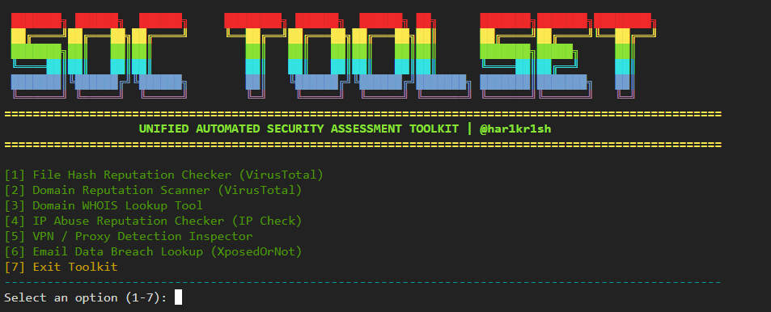

# 🛡️ SOC Toolset (v1.0)

A lightweight, modular collection of Command Line Interface (CLI) tools designed for Security Operations Center (SOC) analysts and incident responders to quickly gather threat intelligence and investigate Indicators of Compromise (IoCs).

---

## 📸 Screenshots

*(To add a screenshot, upload your image to an `assets/` folder in your repository or drag-and-drop an image directly into the GitHub README editor).*



---

## 🛠️ Features & Modules

* **`domain_scan.py`**: Queries domain reputation and passive threat intelligence.
* **`domain_whois.py`**: Fetches registrar, creation date, and ownership details for target domains.
* **`ipcheck.py`**: Conducts IP reputation checks and geolocation lookups.
* **`vpn_detect.py`**: Detects VPNs, proxies, TOR exit nodes, and risky connection types.
* **`vt_hash.py`**: Checks file hash signatures against the VirusTotal database.
* **`breach.py`**: Performs credential exposure and data breach lookups.
* **`main.py`**: Unified entry point for executing tools interactively.

---

## ⚙️ Installation & Setup

### 1. Download / Clone the Repository
```bash
git clone https://github.com/har1kr1sh/soc-toolset-v1.0.git
cd soc-toolset-v1.0
```

### 2. Install Dependencies
```bash
pip install -r requirements.txt
```

### 3. Setup Your Configuration
To protect your sensitive credentials:
1. Navigate to the `config/` directory.
2. Copy the template configuration file:
   ```bash
   cp config/config.example.txt config/config.txt
   ```
3. Open `config/config.txt` in a text editor and add your personal API keys (VirusTotal, ProxyCheck, etc.).

---

## 🚀 Usage

Run individual scripts directly from your terminal depending on your analysis needs:

```bash
# Interactive Main Menu
python main.py

# Individual Tool Execution
python ipcheck.py
python vpn_detect.py
python vt_hash.py
```

---

## ⚠️ Disclaimer

This toolkit is developed strictly for **defensive security, authorized investigations, threat hunting, and educational purposes**. 

* The author assumes **no liability** for misuse or damages resulting from this software.
* Always ensure you have appropriate authorization prior to querying external infrastructure or domains.
